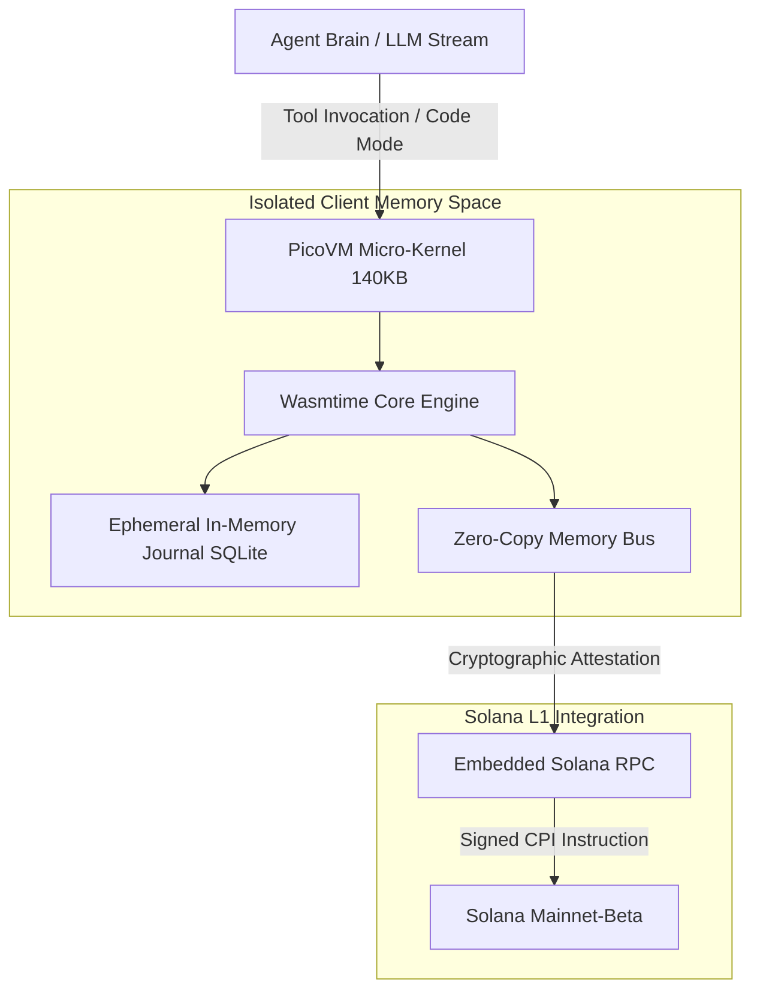

# PICOVM · Sub-atomic WebAssembly Runtime for Frontier Embedded Agents

<p align="center">
  
</p>

<p align="center">
  <b>140KB micro-kernel. Zero container overhead. Microsecond sandbox execution with native Solana RPC settlement.</b>
</p>

<p align="center">
  <a href="https://picovm.xyz"></a>
  <a href="https://crates.io"></a>
  <a href="https://npmjs.com"></a>
  <a href="https://solana.com"></a>
  
</p>

---

## ⚡ Overview

**PicoVM** is a sub-atomic WebAssembly virtual machine engineered specifically for autonomous AI agents and edge environments. 

Traditional AI agent runtimes rely on heavy Docker containers or virtual machines that require hundreds of megabytes of memory and take seconds to boot. PicoVM eliminates container virtualization entirely:

- **140KB Standalone Microkernel**: Compiles directly to client RAM with zero host dependencies.
- **Microsecond Cold Boot (< 420µs)**: Instantaneous instantiation and execution for high-frequency algorithmic decision agents.
- **In-Memory SQLite Journaling**: Real-time snapshotting and ephemeral state rollback.
- **Embedded Solana RPC & CPI Engine**: Direct on-chain transaction assembly and signing from inside the sandboxed WebAssembly execution environment.
- **Code Mode Isolation**: Memory-safe capability boundaries preventing unauthorized network or filesystem access.

---

## 🏗 Architecture



---

## 📊 Benchmark Comparison

| Metric | Docker Container | Firecracker microVM | Wasmer / Wasmtime | **PicoVM** |
| :--- | :--- | :--- | :--- | :--- |
| **Binary Footprint** | ~120 MB | ~25 MB | ~18 MB | **140 KB** |
| **Cold Boot Latency** | ~1,200 ms | ~120 ms | ~8 ms | **< 420 µs** |
| **RAM per Instance** | ~45 MB | ~12 MB | ~4 MB | **< 640 KB** |
| **Native Solana CPI** | No | No | Custom Plugin | **Built-in First-Class** |
| **Deterministic State** | Variable | OS-dependent | Partial | **100% Cryptographic** |

---

## 📦 Installation

### Rust (Cargo)
```toml
[dependencies]
picovm = "0.4.2"
solana-sdk = "1.18"
```

### TypeScript / Node.js
```bash
npm install @picovm/sdk @solana/web3.js
# or
yarn add @picovm/sdk @solana/web3.js
# or
pnpm add @picovm/sdk @solana/web3.js
```

---

## 🚀 Quickstart

### 1. Launching a Sandbox in TypeScript

```typescript
import { PicoVM, AgentRuntime } from '@picovm/sdk';
import { Connection, Keypair } from '@solana/web3.js';

// 1. Initialize PicoVM Microkernel inside RAM
const vm = await PicoVM.init({
  memoryLimitMb: 16,
  networkPolicy: 'solana-rpc-only',
  enableJournal: true
});

// 2. Instantiate Autonomous Solana Trading Agent
const agent = new AgentRuntime(vm, {
  rpcEndpoint: 'https://api.mainnet-beta.solana.com',
  wallet: Keypair.generate()
});

// 3. Execute sandboxed code mode logic
const result = await agent.eval(`
  const price = await solana.getOraclePrice("SOL/USD");
  if (price < 185.00) {
    return solana.executeMarketOrder({ pair: "SOL/USDC", amount: 1.5 });
  }
  return { status: "HOLD", currentPrice: price };
`);

console.log("Agent Execution Output:", result);
```

### 2. Rust Kernel Evaluation

```rust
use picovm::{PicoRuntime, SandboxConfig, SolanaContext};

#[tokio::main]
async fn main() -> Result<(), Box<dyn std::error::Error>> {
    let config = SandboxConfig {
        max_gas: 1_000_000,
        enable_sqlite_journal: true,
        allow_syscalls: false,
    };

    let mut runtime = PicoRuntime::new(config)?;
    let bytecode = include_bytes!("../fixtures/agent_decision.wasm");

    let result = runtime.execute(bytecode, &[])?;
    println!("Sandbox executed in: {:?}", result.execution_time);
    Ok(())
}
```

---

## 🛠 CLI Tooling

PicoVM provides a zero-install developer CLI for inspecting bytecode and benchmarking execution latency:

```bash
# Run WASM bytecode inside the 140KB microkernel
picovm run ./agent.wasm --rpc https://api.mainnet-beta.solana.com

# Inspect memory usage and cold-boot timing
picovm bench ./agent.wasm --iterations 1000

# Generate cryptographically signed execution receipt
picovm attest ./receipt.json
```

---

## 🔒 Security & Code Mode

PicoVM guarantees strict memory isolation for AI agents executing untrusted or dynamic code:

- **Isolated Virtual Address Space**: WebAssembly linear memory is strictly bound. Out-of-bounds access triggers instantaneous kernel termination.
- **Deterministic Ephemeral State**: Every execution starts from a zero-initialized state; persistent mutations must be explicitly recorded to the SQLite journal.
- **Zero Host File Access**: Agents cannot read `/etc`, host environment variables, or private host keys.
- **Cryptographic State Signatures**: All state transitions produce an Ed25519 execution proof ready for on-chain verification on Solana.

---

## 🌐 Official Links

- **Website**: [https://picovm.xyz](https://picovm.xyz)
- **Solana Mainnet Program ID**: `PicoVM1111111111111111111111111111111111111`
- **Documentation**: [https://docs.picovm.xyz](https://picovm.xyz)

---

## 📄 License

Dual-licensed under either of:
- Apache License, Version 2.0 ([LICENSE-APACHE](LICENSE) or http://www.apache.org/licenses/LICENSE-2.0)
- MIT license ([LICENSE-MIT](LICENSE) or http://opensource.org/licenses/MIT)
